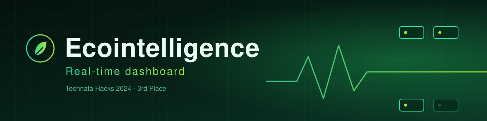
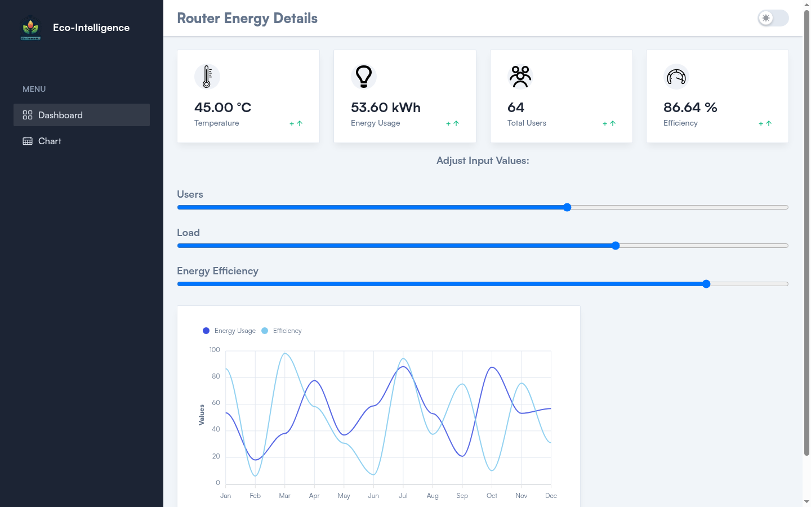
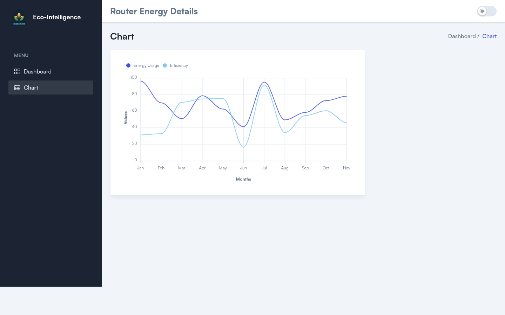
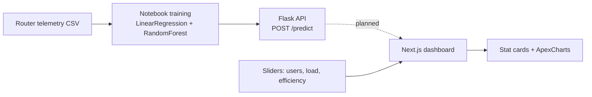

<p align="center">
  
</p>

<p align="center">
  
  
  
  
  
  
</p>

# Ecointelligence - Dashboard

The web front end for **Ecointelligence**, an AI-assisted router energy management project that won **3rd place at Technata Hacks (October 2024)**. It gives IT admins a single view of router temperature, energy usage, load and efficiency, with animated stat cards and an energy-vs-efficiency chart.

> ML backend: [Technata-24-AI_router_Management_System](https://github.com/anakafeel/Technata-24-AI_router_Management_System) (Flask API, notebook, trained models).

## Screenshots





## What it does

- **Router Energy Details** page: four animated stat cards (temperature, energy usage, total users, efficiency) driven by Users, Load and Energy Efficiency sliders, with an ApexCharts line chart.
- **Chart** page: energy usage vs efficiency over the months.
- Light/dark toggle and a sidebar nav.

Honest scope: in this version the metrics are computed in the browser from the slider inputs (simple linear formulas in `src/components/Dashboard/E-commerce.tsx`), and apart from the slider-driven first point the chart series are randomly generated placeholders. The dashboard does **not** call the Flask API yet. The REST wiring (`POST /predict` on the backend repo) is the planned next step. The UI is built on the free [TailAdmin](https://tailadmin.com/) Next.js template, customized with the Ecointelligence pages, branding, sliders and Framer Motion animations.

## How it fits together



## Quick start

Requires Node 18.17+ (verified on Node 24) with `npm ci`, `npm run build` and `npm start` (all 12 pages prerender).

```bash
git clone https://github.com/anakafeel/Eco-Intelligence-dashboard-TechnataHack24.git
cd Eco-Intelligence-dashboard-TechnataHack24
npm ci
npm run dev                 # http://localhost:3000
# or a production build:
npm run build && npm start
```

## Tech stack

Next.js 14 (App Router), React 18, TypeScript, Tailwind CSS, ApexCharts (`react-apexcharts`), Framer Motion.

## Project structure

```
src/
├── app/                      # routes: / (dashboard), /chart, /calendar, /tables, /settings, /forms, /ui
├── components/
│   ├── Dashboard/E-commerce.tsx   # Ecointelligence dashboard (sliders, stat cards)
│   ├── Charts/                    # ApexCharts components
│   ├── Sidebar, Header, Layouts/  # app shell (TailAdmin base)
│   └── ...                        # remaining template components
├── css/, fonts/, hooks/, types/
public/images/                # favicon and assets
.github/assets/               # banner and screenshots
```

## Related

- ML backend: [Technata-24-AI_router_Management_System](https://github.com/anakafeel/Technata-24-AI_router_Management_System)

## Author

**Saim Hashmi** - Computer Systems Engineering, Carleton University. Built at Technata Hacks 2024 (3rd place); commit history in this repo is under Saim's name.
GitHub: [@anakafeel](https://github.com/anakafeel)
